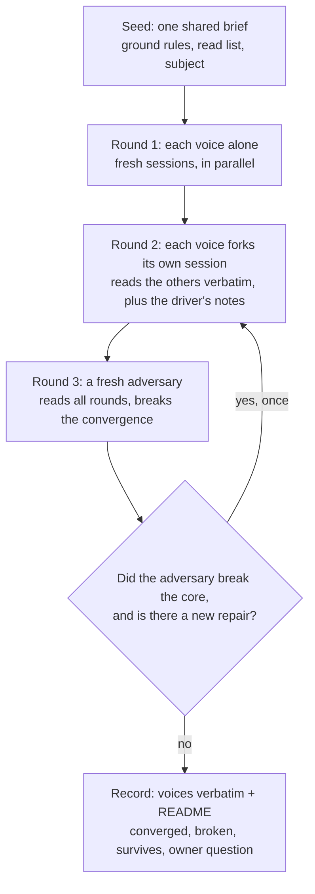

# Running Design Salons

A salon is a conversation between agent sessions, each with a distinct lens, over
rounds. They read each other verbatim, and a fresh adversary then tries to break
what they converged on. It explores an open problem; it does not judge a finished
proposal. A review answers "is this right?". A salon answers "what could this be,
and what kills each idea?".

**Core principle:** the voices must disagree for the right reasons, and the
adversary must not share their assumptions. Everything else serves those two.

## When to use

| Situation | Use |
| --- | --- |
| A candidate exists and the question is whether it holds | a review (`reviewing-a-design-corpus`, or `requesting-code-review` for code) |
| Several reviews in a row broke your recommendation | a salon: the option space is wrong, not the option |
| The owner asks for creativity, exploration, "think like me", sessions in conversation | a salon |
| The problem needs mechanisms from outside the field (physics, biology, another formalism) | a salon with those lenses |
| Shaping an early idea together with the owner, live | `brainstorming` |
| One factual question, one file, one count | neither: look it up |

A salon never gates anything. Whatever the owner will rule on still goes through a
review after the salon, and the salon's output is recorded as proposed, never as
decided.

## The shape



### Seed: one shared brief

Every voice gets the same seed, with only a voice section added. A seed has:

- **The frame.** "You are one voice in a conversation between agent sessions and
  the driver. Explore: invent, combine, question the problem. Label wild ideas as
  wild and say what would kill them. Read-only: change no repository file."
- **Ground rules, verbatim from the owner.** Their words, not your paraphrase: a
  paraphrase drops the clause that later decides the question.
- **A read list with anchors.** File plus section or line, and what to look for
  there. A bare file name buys a skim.
- **The subject as a problem, not as your answer.** State the constraints and the
  cases to cover. Put your own ideas in a separate block labelled "wild, from the
  driver", so voices can attack them rather than inherit them.
- **What is already dead, and what killed it.** One line per idea earlier rounds
  or reviews broke, with the trace or cost that broke it, and "do not repair it".
  Without this list, voices spend the round reviving it.

### Voices: two or three distinct lenses

Choose each lens for the mechanisms it brings, not for its stance:

- a natural-science or formal lens (physicist, biologist, a named theorist's
  formalism), which supplies mechanisms the field has not tried;
- an engineer at the target scale, who prices every idea;
- a lens the problem specifically needs (a theory the project claims to follow, a
  domain the system serves).

"Reviewer A" and "reviewer B" are not lenses. Two voices with one lens converge on
the driver's view. Past four voices, round 2 is mostly reading.

### What every voice returns

Require all of this in the brief; a voice that skips it is not a finished round:

- **Lead with its position** in plain words.
- **Each idea:** what it is; what it borrows and whether that carries weight or is
  decoration; its cost at the target scale per entity at rest, per node, and
  system-wide; what it forbids and what it distinguishes; **what kills it**.
  The full sweep of what a decision moves belongs to `weighing-quality-dimensions`;
  a salon asks for cost and failure, and leaves that sweep to the review after it.
- **An evidence tag on every claim:** (m) modelled here, (d) derived, (e)
  estimate, (o) outside fact not checked, (code) read in the tree, (pos) position.
  An untagged number is treated as (e).
- **One question for each other voice and one for the owner.**
- **What the driver should do next,** and the question the driver should have
  asked but did not. The driver is driven as well as driving.
- **A length cap** (about 100 lines) **and a closing block** the driver can scan:

  ```
  FINAL
  status: done
  checked: <command or model> -> pass | fail (intended)
  found: <file:line> <what is wrong there>
  decided: <choices the voice made that the brief left open>
  notes: <limits of its evidence>
  ```

### Models: tiny, out of the tree, with mutants

Ask voices to back a safety claim with a small, bounded model, piped on stdin
(`python3 -I -`, memory-capped), never written into the repository. **A model is
evidence only if a deliberately broken variant fails it.** For every rule the model
claims is needed, run the variant without that rule and report the step count to
the failure. A model with no failing variant proves only that it checks nothing.
The report states its scope (actors, moves, losses) and what it leaves out.

### Round 2: fork each voice, paste the others verbatim

- **Fork each voice's own session** (`relay queue add NAME --fork JOB --after JOB`).
  Queue round 2 as soon as the last round-1 answer lands and the round-2 briefs
  are written, while the prompt cache is warm; a late fork re-reads the whole
  transcript at full price. It cannot go earlier: a fork needs its parent's
  session, and the brief is fixed when queued, before the others' answers exist.
- **Paste the other voices' round-1 text verbatim.** A summary drops the detail
  that mattered and anchors every voice on your reading.
- **Add a short driver section:** where they converged, the one disagreement that
  matters, and pointed questions. Ask each voice to answer the question put to it,
  steal what is good, and state the design it would now defend in a few lines,
  with its cost and what would still kill it.

### Round 3: a fresh adversary

- **Fresh, never forked.** A fork inherits the voices' assumptions and finds
  nothing they did not.
- Give it a neutral, numbered list of the claims, agreed and disputed alike, with
  no verdicts. It forms its attacks from that list and the sources first, then
  reads every round's file, so the voices' framing does not set its targets.
- Name targets: what all voices assumed, the convergences that carry the most
  weight, any cost claim that depends on a storage layout or a key, ordering
  claims. Ask for counterexamples as models, with step counts.
- It leads with the single most damaging finding, says plainly what survives, and
  rewrites the owner question if the question hides a trade-off. Its rewrite
  supersedes the voices' question.
- An attack can be wrong too. Before reporting a break, re-run its model and check
  that the failing trace is a real behavior of the design.

If a voice answers the adversary in a later round, a mechanism it adds then counts
as a concession plus a redesign, and is labelled that way, not as a rebuttal.

Run another round only if the adversary broke the core and a repair is genuinely
new. Otherwise take it to the owner. Each extra round costs a full set of sessions.

## The driver's part

The driver takes part; it does not forward:

- **writes down its own lean before round 1,** in a file the salon records, and
  judges it like any voice's claim afterwards, so it cannot quietly move the lean
  to match the result;
- seeds its own provocations, labelled wild;
- writes the between-rounds section, choosing the disagreement that matters;
- checks every number and file reference the voices cite before repeating it
  (`reviewing-a-design-corpus` owns that pass);
- **counts agreement for nothing on its own.** A convergence survives only if the
  adversary tested it and it held;
- **records nothing as decided.** Converged is proposed. Rulings come only from the
  owner, and a ruling is recorded where the project records rulings, citing the
  salon as its background.

### Recording

Commit each voice's file verbatim and a README beside them:

- a header: status ("exploration record, not a ruling"), date, voices with model
  and effort, rounds, spend, related documents, where the briefs live;
- a table linking each voice's file per round;
- **where they converged**, proposed, not ruled, with tags kept;
- **what the adversary broke**, and **what survives**;
- **the owner question**, with a pointer to the adversary's rewrite where it exists.

Then tell the owner as a conversation: what each voice proposed, what the adversary
broke, which ideas are new. Then ask the questions, each with its trade-off.

## Common mistakes

| Symptom | Fix |
| --- | --- |
| Every voice's position is a variant of the driver's recommendation | Move the driver's ideas into a "wild, from the driver" block; restate the subject as constraints only |
| Two voices with the same lens, or lenses named "reviewer" | Re-pick lenses by the mechanisms each brings |
| Round 2 brief says "the engineer proposed X" | Paste the engineer's file verbatim |
| The adversary job was queued with `--fork` | Queue it fresh; give it the round files to read |
| A voice reports a model that passes, with no broken variant | Ask for the variant without each rule and its step count to failure |
| A cost is given per operation, but not per entity at rest or system-wide | Ask for all three grains at the target scale |
| The README or spec says "the salon decided" | Change it to "proposed, not ruled"; take the question to the owner |
| The owner question offers one option and a straw man | Use the adversary's rewrite, which names the trade-off |
| Round 2 queued hours after round 1 | Write the round-2 briefs as soon as the last round-1 answer lands, and queue the forks then. Not earlier: a fork needs its parent's session, and its brief is fixed when queued |
| The driver's lean is first written down after the voices answer | Write it before round 1; score it with the rest |
| Voices agreed, so the claim is reported as settled | Survives only after the adversary tested it |
| A voice's round-1 idea is the one a review already broke | Add a "dead, do not repair" block to the seed, with what killed each |
| A rebuttal adds a new mechanism and calls the attack answered | Record it as conceded and redesigned |
| A fourth round started with no new repair on the table | Stop; take the open question to the owner |

## Quick reference

- Seed: frame, owner's ground rules verbatim, anchored read list, subject as a problem, driver's ideas labelled wild.
- Voices: 2-3 lenses chosen for their mechanisms; one prices at the target scale.
- Return: position first; per idea, borrows, cost at three grains, forbids, kills it; evidence tags; questions; FINAL.
- Models: stdin, bounded, a failing variant per needed rule.
- Round 2: fork own session, others verbatim, driver's convergence, disagreement and questions.
- Round 3: fresh adversary, named targets, counterexamples, what survives, rewritten owner question.
- Record: voices verbatim, README, proposed not ruled; owner told as a conversation.

The `relay` skill owns the commands (`queue add`, `--fork`, `--after`, profiles,
landing), and is the default runner. Round 2 needs a harness that can fork; relay
refuses `--fork` on one that cannot (omp, for one). For such a voice, or with no
relay at all, queue round 2 fresh and paste the voice's own round-1 output at the
top of its round-2 brief.
